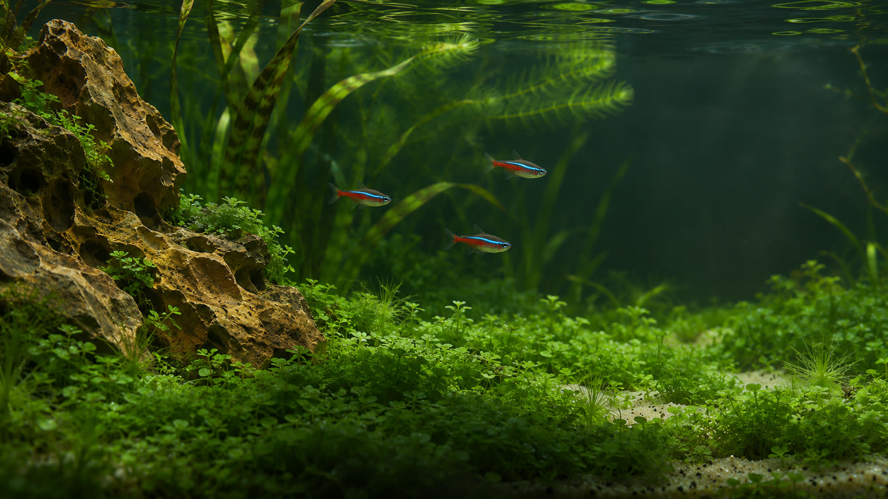

# 生态鱼缸

一个用 Three.js 做的互动淡水鱼缸。在客厅里观察鱼群和昼夜光线，也可以喂鱼、移动水草和石头、调整底床。



*上图是用 ImageGen 制作的加载页素材。*

## 本地运行

克隆仓库后，用支持 WebGL 2 的浏览器打开 `index.html`。Three.js、模型和贴图都随项目提供，可以离线打开。

```sh
git clone https://github.com/Jason-YCX/cyber-eco-fish-tank.git
cd cyber-eco-fish-tank
```

也可以在仓库目录启动本地服务器，再访问 [http://127.0.0.1:8000](http://127.0.0.1:8000)。

```sh
python3 -m http.server 8000 --bind 127.0.0.1
```

## 怎么玩

| 操作 | 用法 |
| --- | --- |
| 观察鱼缸 | 拖动画面转动视角。用滚轮或双指捏合缩放。 |
| 喂鱼 | 打开右上角的物品抽屉，选「喂食」，再点击水面。 |
| 布置水草和石头 | 在抽屉里旋转查看模型，点「＋」入缸。在对应的布置模式下拖动物品。 |
| 调整底床 | 从细砂、草泥、暖红砂和河砾中选择。进入底砂模式后，在砂面上下拖动塑形。 |
| 查看昼夜 | 开场光线随本地时间变化。在抽屉的「光影」里可指定时刻或快放。 |

默认鱼缸有 14 条宝莲灯，以及各 6 条孔雀鱼、熊猫鼠鱼和小精灵鱼。矮珍珠为主的草毯中穿插挖耳草，前方留有裸砂。气石的气泡会随上升微微膨胀、变形，在水面消散。

## 项目结构

- `index.html`、`main.js`、`styles.css` 负责入口、加载页与交互。
- `scene.js`、`aquarium-*.js` 负责默认布景、灯光、玻璃、水面和气泡。
- `fish-*.js`、`plant-model.js`、`stone-model.js` 和 `sand-physics.js` 负责生物模型、摆动、碰撞与底砂塑形。
- `assets/` 保存运行素材及其来源，`tools/` 保存建模和素材校验脚本。

安装 Node.js 后，可在仓库根目录运行 `node tools/check_tiger_leaf.cjs`，复核三种虎纹苦草网格的叶缘配准。

## 素材来源

第三方素材的署名、许可及加工说明以各目录的记录为准。

[鱼类](assets/fish/SOURCES.md) · [水草](assets/plants/SOURCES.md) · [石材](assets/stone/SOURCES.md) · [底砂](assets/substrate/SOURCES.md) · [客厅材质](assets/living-room-textures/SOURCES.md) · [Three.js 许可](vendor/LICENSE-three.txt)
